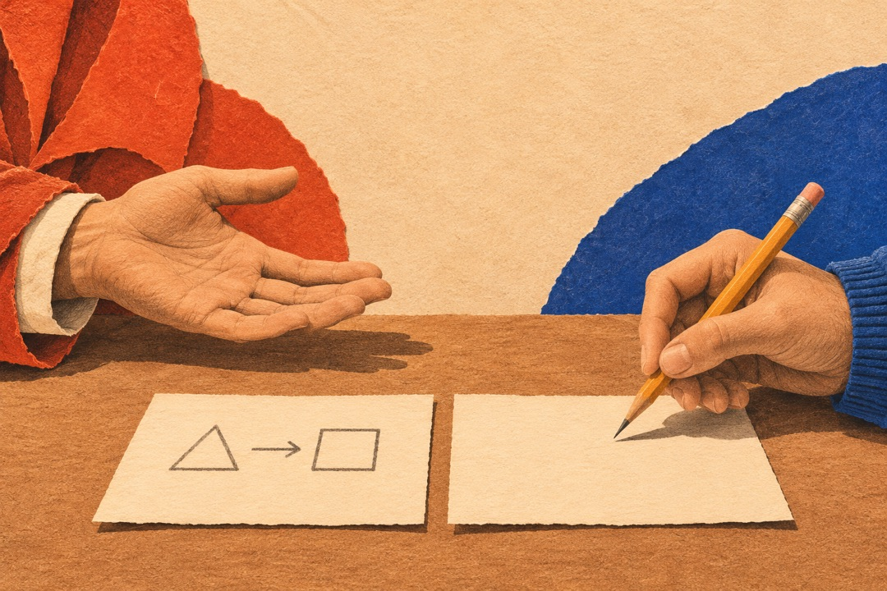

# Teaching AI

**AI literacy is not just knowing which button to click.** It's being able to ask a useful question, make something, and decide whether the result deserves your trust.

I've taught at NJIT for more than two decades. The tools have changed a lot. What still makes teaching worthwhile is seeing someone go from “I don't know where to start” to “I can figure this out.”

## The Tests Passed. Who Won the Game?

A round of Rock, Paper, Scissors gives me a question to ask after the automated checks pass. What result did the student expect when they played? The feature follows three courses and the choices I make about when an AI coach should speak and when it should wait. [Read the classroom story](/teaching/when-ai-helps-write-the-code)

## Build something you can explain

I call these activities *Studios*. Students try the starter, decide on one change, build it with help, check what happened, and choose what to keep. A short instruction file called `AGENTS.md` tells the AI how to coach that particular lesson. The decision left to the student changes with the course.

| Studio | A decision the student owns |
| --- | --- |
| [Brand Studio · Intro to Website Development](https://github.com/kaw393939/is117-brand-studio) | Choose an audience for a plain white T-shirt. Show where that choice changed the storefront or its voice. |
| [Rock, Paper, Scissors · Building Web Applications](https://github.com/kaw393939/is218-rps-starter) | Agree on the rule for one round. Explain a test and check the result by playing the game. |
| [Server Studio · Content Management Systems](https://github.com/kaw393939/373_hosting) | Predict how a request will reach a calculator running on the student's server. Open the public address and check the prediction. |

The <a href="/knowledge-lab/">Knowledge Lab</a> takes the same habit into retrieval. When an AI answers from a collection of documents, can the student find the passage that supports the answer? What happens when the information is missing?

## Try a Studio in your course

Start with an assignment you already teach. Choose one moment when you want to hear the learner's reasoning before the assistant offers an answer. The starter helps you rehearse that exchange and produces a student handout and a set of coaching instructions. The teacher copy contains answers. Share only `LESSON.md` and `AGENTS.md` with students. [Download the teacher Studio starter](/downloads/AI-Studio-Starter.zip)

For the decisions behind the design, the field notes connect classroom and engineering research to specific choices about hints, evidence, and follow-up questions. [Read the Studio field notes](/teaching/studio-field-notes)

## Learning beyond one assignment

When AI helps produce an assignment, how do we know what the student can do the next time? That's the question behind my [research on learning and judgment](/research). The [AI career field guide](/ai-careers) gives students a way to choose a project around a responsibility they might encounter at work.

I also publish the tools behind the teaching. The Educational Design System supplies reusable layouts for course materials. Everyday AI CLI is an alpha toolkit for repeatable AI tasks. [Explore the Educational Design System](https://kaw393939.github.io/educational-design-system/) · [See Everyday AI CLI](https://github.com/kaw393939/everyday-ai-cli)
