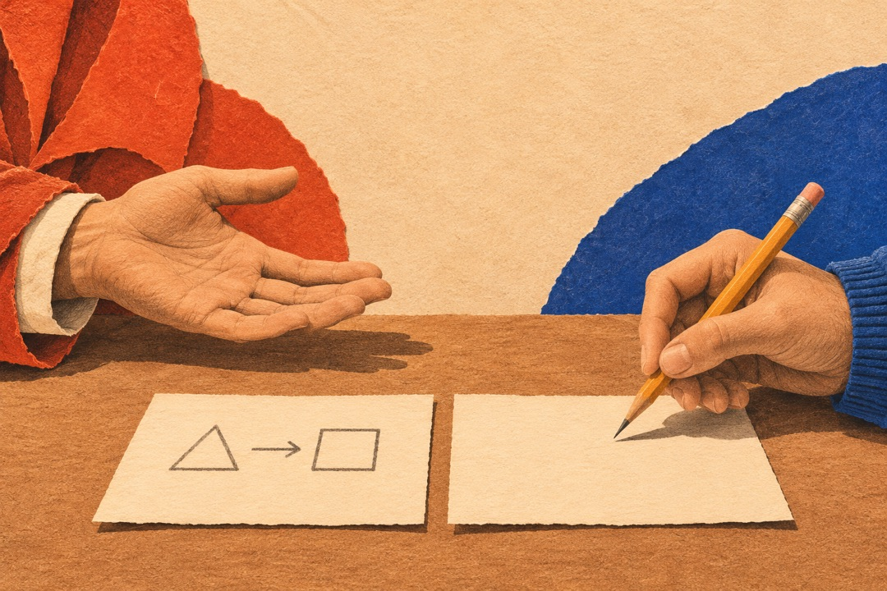

# The Tests Passed. Who Won the Game?

Choose rock. The computer chooses paper. You know who won. The game I gave my web applications students at NJIT had no idea.

The starter passed all twelve automated checks. The page loaded. It could display a result if a test supplied one. It even knew how to explain that the game was unfinished. The function that had to **decide** who won was still a placeholder. If you wanted to know who had won, you still had to settle the round yourself. [Inside the starter trial](https://github.com/kaw393939/218_spec/blob/main/research/2026-10-25-rps-student-trial.md) · [What the tests checked](https://github.com/kaw393939/is218-rps-starter/blob/55029c04d60e2c2b19e923defc82af24e9c4b9da/tests/test_shell.py)

I left that hole on purpose. A coding agent could fill it in seconds. What I wanted to hear was a student saying, before anyone touched the code, *I picked rock. If the computer picks paper, the screen should tell me I lost.* That last word matters. A game can identify the winning move and still congratulate the wrong person.

## The coach that kept asking why

I call these assignments Studios. A student makes something, tries it, and decides what to change. In the project folder is a plain-text file called `AGENTS.md`. It tells an AI coding assistant how to act during that particular lesson. A teacher can open the file, read the directions, and change them. One of the hardest directions to get right is when to wait.

I learned that from another Studio. In my introductory web course, students design a brand for a plain white T-shirt. To rehearse the assignment, I used a second AI to play a learner who kept answering “yes.” My coaching agent wanted a reason for the choice of audience. It asked. It rephrased. It asked again. The learner could have been unsure, tired, or ready to move on. My instructions had turned a reasonable question into a trap.

I changed the coach so it could offer one example and let the learner pause. A yes could approve a brand name. The reason the name fit a particular buyer could stay open until the learner had one. That rehearsal exposed a problem in my instructions. A simulated learner could help me find it. Only a classroom could tell me what real students would do next. [The coaching review](https://github.com/kaw393939/is117-brand-studio/blob/main/docs/coaching-review-2026-10-25.md)

<figure class="editorial-figure">
  
  <figcaption>The first card can show a method. The blank one gives the learner somewhere to start. Editorial illustrations generated with AI.</figcaption>
</figure>

## Change one thing and hand over the keyboard

What can someone carry into the next problem? In a randomized study, Judy Hanwen Shen and Alex Tamkin asked 52 developers to use an unfamiliar Python library. All 26 who had an AI assistant finished both tasks within the time limit. Twenty-two of the 26 working independently did. On an immediate quiz without AI, the assisted group averaged about four points lower out of 27. They tested one library in one short session. What caught my attention was how much easier it would have been to see the finished tasks than to notice the gap on the quiz. [Read the revised study](https://arxiv.org/html/2601.20245v3)

In my content management course, the project is a tool that answers questions from a set of documents. For the first answer, the coach can ask the student to find the passage that supports it. For the next round, I can ask for a detail the documents leave out and hand the keyboard over. If I immediately say “check the source,” I’ve already made the most interesting decision for the student. Waiting leaves room for them to notice the missing evidence, ask for help, or surprise me with a better check. <a href="/knowledge-lab/students/check#five-questions-to-prepare" target="_self">Try a supported question and a missing-evidence question</a>.

That moment has a workplace counterpart. A customer sees “request received” and walks away. The engineer sitting beside them can ask what the person at the other end actually received. Switch to that person’s view. Find the request. Give them the keyboard. That is one piece of forward-deployed engineering I can bring into a classroom today.

## Try it in the next fifteen minutes

The downloadable Studio starts with a question anyone can teach. A help desk changed its schedule. Five recorded waits used to be **4, 5, 5, 6, and 30 minutes**. Now they’re **6, 6, 7, 7, and 9**. Did service improve?

Give someone a moment with the numbers. The average fell from ten minutes to seven. The middle person waited seven minutes instead of five. Now introduce a visitor with ten minutes between classes. What would your learner check first? Listen for who raises the question of how long the appointment itself takes.

To adapt this for your class, open the teacher guide and paste it into an AI chat with one assignment you already teach. Ask it to help you build a Studio. Pick the decision you want students to own. Play a stuck student yourself. If the first hint gives the decision away, revise that line and try it again. The download includes a paper-based route. **The ZIP is the teacher copy and contains answers. Give students only `LESSON.md` and `AGENTS.md`.** [Download the teacher Studio](/downloads/AI-Studio-Starter.zip) · [Open the teacher guide](https://github.com/kaw393939/kaw393939.github.io/blob/main/examples/ai-studio-starter/TEACHER-STUDIO.md)

At hand-in, I want one moment I can ask about. They can choose a question that changed their work, point to the change, and show how they checked it. They can also mark a draft or explain the choice aloud. If the conversation already lives next to the fix, a link can spare everyone another reflection paper. [The classroom accounts and research behind the starter](/teaching/studio-field-notes)

The question I keep coming back to is one I’d also ask someone mentoring a new engineer. **What do you ask on the first round that you hope they’ll ask for themselves on the second?**
